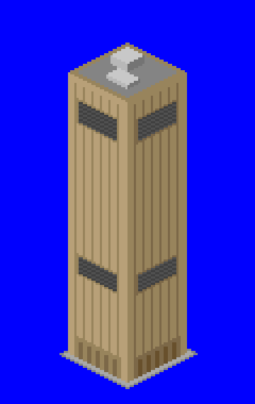

# AT&T Long Lines Building NewGRF

A 1x1 town building that adds the AT&T Long Lines Building (33 Thomas Street, New York, 1974) to OpenTTD.



## What it does

| | |
|---|---|
| Footprint | 1 tile. A bulky 14x14 slab, wider than the base-set offices |
| Look | Windowless grey-beige granite skin with vertical panel ribs, heavy corner piers, a recessed street-level base and two bands of louvred air intakes |
| Height | 132 px to the roof |
| Spawning | Towns never build it on their own (probability 0). Place it by hand with the house picker, under "Town centre" |
| Climates | Temperate, sub-arctic and sub-tropical |
| Gameplay | A telephone exchange, so it has a small population (40) but maximum mail. Accepts passengers, mail and goods. Protected from town rebuilding |

## Scale

* The tallest base-set offices are 100-110 px, and the [Twin Towers](../twin_towers) are 172 px.
* The real building is 167 m against the towers' 417 m. At that true ratio it would be shorter than a base-set office, which would look wrong for a building that dominates its block. So it sits between the two at 132 px.

## Building

Requires Python 3 with Pillow, and [NML](https://github.com/OpenTTD/nml) (`pip install nml`).

```sh
cd mods/att_long_lines
python3 tools/make_sprites.py           # regenerates gfx/*.png and att_long_lines.nml
nmlc -c --grf=att_long_lines.grf att_long_lines.nml
```

Copy `att_long_lines.grf` into your OpenTTD `newgrf/` folder and enable it in the NewGRF settings before starting a new game.

To place it in a game, set **Settings > Environment > Towns > Placing individual town houses** to "allowed" or "fully constructed". Then pick **Place houses** from the town toolbar menu, choose the "Town centre" tab and click the building. The scenario editor always has the house picker.

This is a standalone GRF for now (grfid `TT\01\02`). It is expected to move into a larger building pack later.

## Files

* `tools/make_sprites.py` draws the sprite in OpenTTD's isometric projection and writes the NML. Edit this rather than the generated files.
* `tools/ttd_palette.png` is the TTD palette that the sprite is drawn in.
* `gfx/att_long_lines.png` is the generated sprite sheet (8bpp, normal zoom only).
* `lang/english.lng` holds the strings.
