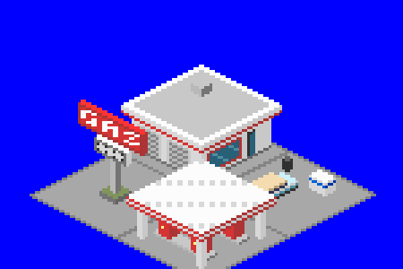

# Service Station NewGRF

A 2x2 town building that adds a 1950s roadside service station to OpenTTD.



## Layout

| Tile | What's on it |
|---|---|
| North (back) | The garage: a white enamel office with a red-framed plate-glass front and a glass door, two roll-up service bays, and a flat roof slab with a red-and-white fascia |
| West (left) | A tall red GAS sign on a pole with a price board, set in a small planter, and a red air/water post |
| East (right) | Customer parking with a parked two-tone turquoise-and-cream car, an ice cooler and a tyre stack |
| South (front) | The pump canopy on four white posts over two concrete islands, each with two red pumps |

## Details

* **Spawning:** towns never build it on their own (probability 0). Place it by hand with the house picker, under "Town centre". Once placed it is protected from town rebuilding.
* **Climates:** temperate, sub-arctic and sub-tropical.
* **Gameplay:** population 10. It mostly accepts goods.
* **Brand:** the brand is generic (red and white, "GAS"), so it doesn't copy any real oil company's livery.

## Scale

* The garage is one storey, 13 px to the roof plus a 3 px roof slab, in line with the base-set small houses.
* The canopy clears 12 px, about one storey, and the GAS sign stands 29 px tall so it reads from a distance.
* Each tile's sprite stays inside its own tile and bounding box, so the four tiles sort correctly against each other and against neighbouring buildings.

## Building

Requires Python 3 with Pillow, and [NML](https://github.com/OpenTTD/nml) (`pip install nml`).

```sh
cd mods/gas_station
python3 tools/make_sprites.py           # regenerates gfx/*.png and gas_station.nml
nmlc -c --grf=gas_station.grf gas_station.nml
```

Copy `gas_station.grf` into your OpenTTD `newgrf/` folder and enable it in the NewGRF settings before starting a new game.

To place it in a game, set **Settings > Environment > Towns > Placing individual town houses** to "allowed" or "fully constructed". Then pick **Place houses** from the town toolbar menu, choose the "Town centre" tab and click Service Station. The scenario editor always has the house picker.

This is a standalone GRF for now (grfid `TT\01\05`). It is expected to move into a larger building pack later.

## Files

* `tools/make_sprites.py` draws all four tiles in OpenTTD's isometric projection and writes the NML. Edit this rather than the generated files.
* `tools/ttd_palette.png` is the TTD palette that the sprites are drawn in.
* `gfx/gas_station.png` is the generated sprite sheet (8bpp, normal zoom only).
* `lang/english.lng` holds the strings.
