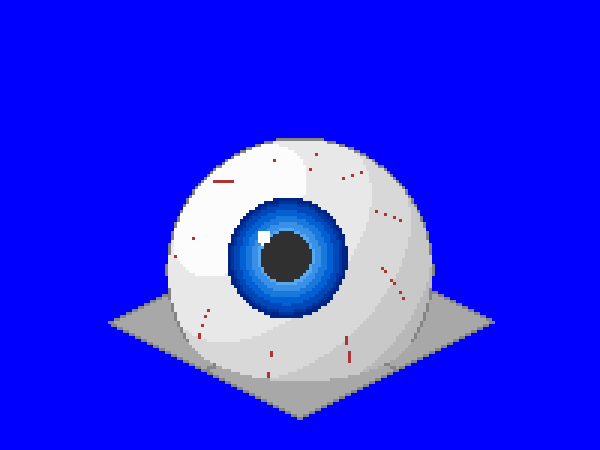

# Las Vegas Eye NewGRF

A 2x2 town building that adds the Las Vegas Sphere (2023) to OpenTTD, showing its famous giant-eyeball display.



## What it does

| | |
|---|---|
| Footprint | 2x2 tiles, with the dome inscribed in the footprint so nothing overhangs the roads |
| Look | A white eyeball with a blue iris and pupil looking up and to the left, faint red veins, and lighting from the upper left |
| Height | 56 px to the top of the dome, about 90 px across on screen |
| Spawning | Towns never build it on their own (probability 0). Place it by hand with the house picker, under "Town centre" |
| Climates | Temperate, sub-arctic and sub-tropical |
| Gameplay | An arena, so it has lots of visitors (population 200) and little mail. Accepts passengers, mail and goods. Protected from town rebuilding |

## Scale and shape

* OpenTTD draws one horizontal world unit as 2 px across and one height unit as 1 px. For the dome to look round on screen, it is an ellipsoid whose vertical radius is √6 times its horizontal radius.
* Houses can be at most 2x2 tiles, so the dome's width is capped at the 32x32 footprint. That cap, not the real 112 m height, sets its size.
* The real Sphere is 157 m wide and 112 m tall, so its centre sits below half height and the dome is a little wider than it is tall.
* Every screen pixel is ray-cast to the point it hits on the dome, and goes into the sprite of the tile under that point. This splits the dome cleanly across the four tiles, and keeps each tile's pixels inside its own bounding box so it sorts correctly against vehicles and neighbours.

## Building

Requires Python 3 with Pillow, and [NML](https://github.com/OpenTTD/nml) (`pip install nml`).

```sh
cd mods/las_vegas_eye
python3 tools/make_sprites.py           # regenerates gfx/*.png and las_vegas_eye.nml
nmlc -c --grf=las_vegas_eye.grf las_vegas_eye.nml
```

Copy `las_vegas_eye.grf` into your OpenTTD `newgrf/` folder and enable it in the NewGRF settings before starting a new game.

To place it in a game, set **Settings > Environment > Towns > Placing individual town houses** to "allowed" or "fully constructed". Then pick **Place houses** from the town toolbar menu, choose the "Town centre" tab and click Las Vegas Eye. The scenario editor always has the house picker.

This is a standalone GRF for now (grfid `TT\01\03`). It is expected to move into a larger building pack later.

## Files

* `tools/make_sprites.py` ray-casts the dome, paints the eye and writes the NML. Edit this rather than the generated files.
* `tools/ttd_palette.png` is the TTD palette that the sprites are drawn in.
* `gfx/las_vegas_eye.png` is the generated sprite sheet (8bpp, normal zoom only).
* `lang/english.lng` holds the strings.
