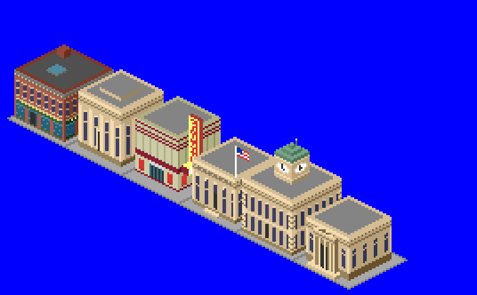

# Small-Town Downtown NewGRF

Six 1x1 town buildings for a small town's Main Street, built between 1900 and 1960.



## The buildings

| Building | Era | Look | Gameplay |
|---|---|---|---|
| Brick Commercial Block | c.1905 | Two storeys of red brick, a shopfront with plate-glass display windows and a recessed door, a painted sign band, sash windows with stone sills and lintels, and a pressed-tin cornice | Population 30. Accepts goods |
| Town Bank | c.1920 | A limestone Neoclassical bank with pilasters, tall windows, a granite plinth, a frieze and a dentil cornice | Population 20. Lots of mail |
| Roxy Theatre | c.1948 | An Art Deco cinema in cream stucco with fluting and maroon streamline bands, glass lobby doors between poster cases, a bulb-lit marquee and a vertical ROXY blade sign | Population 40. Lots of passengers |
| Post Office | c.1915 | One tall limestone storey of round-arched windows, lettering in the frieze, steps to the door and a flagpole flying the US flag | Population 15. Maximum mail |
| Town Hall | c.1910 | Two limestone storeys with rusticated corner quoins and a belt course, topped by a clock cupola with a stepped verdigris copper roof and a gold finial | Population 35. Passengers and mail |
| Carnegie Library | c.1905 | A limestone library on a raised basement, with a columned portico and pediment over wide front steps | Population 15 |

All six are 1x1 houses that towns never build on their own (probability 0). You place them by hand with the house picker, under "Town centre". Once placed they are protected from town rebuilding. They work in temperate, sub-arctic and sub-tropical climates.

## Scale

* Base-set small offices are about 30 px tall, at roughly 10 px per storey.
* These are two-storey Main Street buildings at 27-31 px to the roof, so they line up with the base-set shops and offices.
* The theatre's blade sign rises to 40 px, the post office flagpole to 43 px and the town hall's clock cupola to 52 px.
* The bank, post office, town hall and library share one limestone palette and cornice detail, so they read as a matching civic set.
* The bank is set back on a 12x12 footprint. The brick block fills its lot at 14x14, and the theatre's marquee hangs out over the sidewalk.

## Building

Requires Python 3 with Pillow, and [NML](https://github.com/OpenTTD/nml) (`pip install nml`).

```sh
cd mods/small_town_downtown
python3 tools/make_sprites.py           # regenerates gfx/*.png and small_town_downtown.nml
nmlc -c --grf=small_town_downtown.grf small_town_downtown.nml
```

Copy `small_town_downtown.grf` into your OpenTTD `newgrf/` folder and enable it in the NewGRF settings before starting a new game.

To place the buildings in a game, set **Settings > Environment > Towns > Placing individual town houses** to "allowed" or "fully constructed". Then pick **Place houses** from the town toolbar menu and choose the "Town centre" tab. The scenario editor always has the house picker.

This is a standalone GRF for now (grfid `TT\01\04`). It is expected to move into a larger building pack later.

## Files

* `tools/make_sprites.py` draws all six buildings in OpenTTD's isometric projection and writes the NML. Edit this rather than the generated files.
* `tools/ttd_palette.png` is the TTD palette that the sprites are drawn in.
* `gfx/small_town_downtown.png` is the generated sprite sheet (8bpp, normal zoom only).
* `lang/english.lng` holds the strings.
