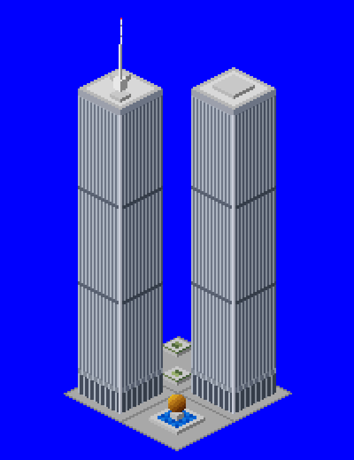

# Twin Towers NewGRF

A 2x2 town building that adds the Twin Towers of the World Trade Center to OpenTTD.



## What it does

| | |
|---|---|
| Footprint | 2x2 tiles: North Tower (with antenna) on the west tile, South Tower on the east tile, a planted plaza behind and The Sphere fountain in front |
| Height | Towers are 172 px tall; the antenna tops out at 196 px above the north corner |
| Spawning | Never built by towns on their own (probability 0). Place it by hand with the house picker, under "Town centre" |
| Climates | Temperate, sub-arctic and sub-tropical |
| Limits | Flagged as protected, so the town won't replace it once placed |
| Gameplay | Population 255, high mail, accepts passengers, mail and goods |

## Scale

Sizes were measured against the base-set buildings (OpenGFX, normal zoom):

* A tile is 64 x 32 px and one unit of height is 1 px.
* The tallest base-set offices have a bounding box 100-110 px tall, and their sprites are at most 149 px.
* OpenTTD only redraws up to `MAX_BUILDING_PIXELS` (200 px) above a tile's north corner (`src/tile_type.h`). Anything higher leaves glitches when the screen scrolls.

The towers stand about 1.6x the tallest base-set office block, with the antenna just under the 200 px limit. True scale would be roughly 3-4x taller, which the engine can't draw. Each tower sits in a 12x12 footprint centred on its tile, the same chunky proportions as the base-set offices.

## Building

Requires Python 3 with Pillow, and [NML](https://github.com/OpenTTD/nml) (`pip install nml`).

```sh
cd mods/twin_towers
python3 tools/make_sprites.py           # regenerates gfx/*.png and twin_towers.nml
nmlc -c --grf=twin_towers.grf twin_towers.nml
```

Copy `twin_towers.grf` into your OpenTTD `newgrf/` folder and enable it in the NewGRF settings before starting a new game.

To place it in a game, set **Settings > Environment > Towns > Placing individual town houses** to "allowed" or "fully constructed". Then pick **Place houses** from the town toolbar menu, choose the "Town centre" tab and click Twin Towers. In the scenario editor the house picker is always available.

This is a standalone GRF for now (grfid `TT\01\01`). It is expected to move into a larger building pack later.

## Files

* `tools/make_sprites.py` draws the sprites in OpenTTD's isometric projection, so every pixel lines up with the bounding boxes, and writes the NML. Edit this rather than the generated files.
* `tools/ttd_palette.png` is the TTD palette that the sprites are drawn in.
* `gfx/twin_towers.png` is the generated sprite sheet (8bpp, normal zoom only).
* `lang/english.lng` holds the strings.
